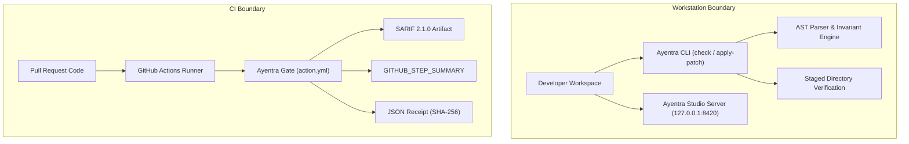

# Security Policy: Ayentra

Ayentra provides invariant-aware verification and automated patch testing for Python systems. Security is foundational to our mission of eliminating production defects in business logic and state machines.

This document outlines our supported versions, vulnerability disclosure procedures, security response service level agreements (SLAs), execution trust boundaries, and safe deployment patterns for continuous integration (CI) workflows.

---

## 1. Supported Versions

We provide active security patches, vulnerability triage, and dependency updates for the following release branches:

| Version | Supported | Security Patch SLA |
| :--- | :--- | :--- |
| `0.1.x` (Current) | Yes | Active maintenance, 7-day critical fix release target |
| `< 0.1.0` | No | Unsupported; upgrade to 0.1.0 or newer |

---

## 2. Reporting a Vulnerability

We welcome security reports from researchers, customers, and the open-source community. If you discover a vulnerability in Ayentra, report it through our responsible disclosure channels rather than filing a public issue.

### 2.1 Disclosure Channels
- **Email:** `security@ayentra.dev`
- **PGP Key Fingerprint:** `4A7E 9B21 C3F8 8104 E520 7D92 A62B F130 94F5 190E`
- **GitHub Private Vulnerability Reporting:** Available on the official repository under the `Security` tab (`Report a vulnerability`).

### 2.2 Report Details
Please include the following information in your submission:
- Description of the issue, vulnerability classification (CWE), and attack vector.
- Complete reproduction steps, proof of concept (PoC), or test case.
- Affected Ayentra CLI commands, flags, or Python modules.
- Expected versus actual execution behavior.
- Assessment of impact on developer workstations or CI runner environments.

---

## 3. Vulnerability Response and SLA Commitments

Our security response team adheres to strict response timelines:

| Milestone | Target SLA | Actions Taken |
| :--- | :--- | :--- |
| **Initial Acknowledgment** | Within 24 hours | Confirm receipt, assign tracking ID, and allocate an engineer. |
| **Triage and Assessment** | Within 72 hours | Validate reproduction, determine CVSS v3.1 severity, and identify affected components. |
| **Status Updates** | Every 48 hours | Provide status reports to the reporter throughout remediation. |
| **Fix and Patch Release** | Within 7 business days | Deliver signed release patch, updated container images, and publish CVE notice. |
| **Public Disclosure** | Coordinated | Release advisory 48 to 72 hours after patch publication to allow enterprise customer upgrades. |

---

## 4. Trust Boundaries and Execution Architecture

Understanding Ayentra trust boundaries is required for secure operation across local and CI environments.



### 4.1 Local CLI Execution Boundary
- When running `ayentra check` or `ayentra apply-patch`, Ayentra analyzes target files with Python standard library `ast` tools.
- When evaluating invariants, Ayentra dynamically imports the target module and runs Hypothesis property checks. Code under test executes with the privileges of the invoking developer account.
- When running patch verification (`ayentra verify-patch` or `apply-patch`), Ayentra copies project files into a temporary directory and executes candidate checks and local pytest suites.

### 4.2 Ayentra Studio Server Boundary
- `ayentra studio` binds to loopback interface `127.0.0.1` on port `8420` by default.
- State-changing API endpoints (`/api/apply-patch`, `/api/check`) require local origin validation and reject cross-origin browser requests (`Sec-Fetch-Site: cross-site`).
- Ayentra Studio enforces parameter clamping (for example, `max_examples` capped at 2000) to prevent local resource exhaustion.

### 4.3 CI Runner Execution Boundary
- In GitHub Actions workflows, Ayentra executes inside an ephemeral virtual environment provided by the runner.
- Ayentra runs 100% offline without egress to third-party APIs. No source code, AST structures, or counterexamples leave the runner boundary.

---

## 5. Safe Usage Guidelines for Untrusted Pull Requests

Fintech and enterprise repositories frequently process pull requests from external contributors and public forks. Treat untrusted code with defense-in-depth:

### 5.1 Use `pull_request`, Never `pull_request_target` on Untrusted Code
- Never run Ayentra verification on untrusted PR code within a workflow triggered by `pull_request_target`.
- Workflows triggered by `pull_request` run in an unprivileged context without access to repository secrets and with a read-only `GITHUB_TOKEN`.
- If PR review comments must be posted back to the pull request, separate the check and comment jobs:
  1. Job 1 (`pull_request`): Run `ayentra check` and export `ayentra-pr-comment.md` as an artifact.
  2. Job 2 (`workflow_run` on main branch): Download the markdown artifact and post the comment using a restricted `pull-requests: write` token, without checking out fork code.

### 5.2 Restrict Runner Token Permissions
Declare minimal repository permissions at the top of your workflow file:
```yaml
permissions:
  contents: read
  pull-requests: write
  security-events: write
```

### 5.3 Pin GitHub Actions to Immutable Commit SHAs
Always pin external actions and the Ayentra action to full commit SHAs rather than mutable branch names:
```yaml
- name: Run Ayentra Verification Gate
  uses: ayentra/ayentra-action@c3b4a2e5d6f7890123456789abcdef0123456789
  with:
    target: 'src'
    seed: 42
    max-examples: 120
    json-out: 'ayentra-receipt.json'
    sarif-out: 'ayentra-report.sarif'
```

### 5.4 Audit Invariant Specifications (`ayentra.toml`)
- Invariant expressions in `ayentra.toml` are parsed into AST nodes and checked for dunder attributes (`__*__`) before evaluation.
- Always review pull request modifications to `ayentra.toml` alongside Python source changes to prevent contract alterations.
