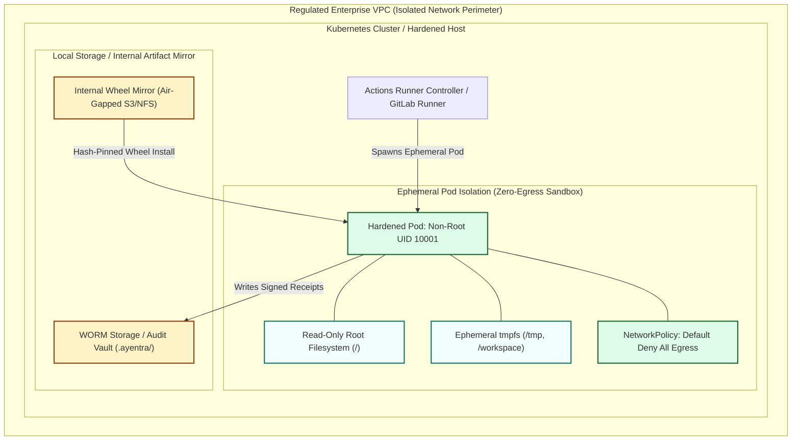

# Ayentra Enterprise Air-Gapped & Self-Hosted Runner Deployment Hardening Guide

**Document Classification:** Enterprise FinTech Infrastructure Security Standard  
**Release Version:** Ayentra v0.1.0  
**Effective Date:** 2026-11-03  
**Target Environments:** Self-Hosted Kubernetes (Actions Runner Controller / GitLab Runner Operator), Hardened Linux Virtual Machines, Air-Gapped High-Performance Compute Clusters  

---

## 1. Scope and Deployment Architecture

In regulated financial technology environments (payment gateways, card issuers, multi-tenant ledgers, and capital markets platforms), continuous integration runners process sensitive source code, business rules, and mathematical invariants.

Ayentra operates 100% offline without telemetry or third-party cloud socket connections. This guide defines the defensive deployment baseline required to execute `ayentra check` and `ayentra apply-patch` on self-hosted, air-gapped runners with zero network egress, unprivileged container sandboxing, and tamper-evident audit trails.



---

## 2. Ephemeral Container and Runner Isolation Profile

Every Ayentra execution job should run within an ephemeral, single-use container or virtual machine that is destroyed immediately after execution.

### 2.1 Kubernetes Hardened Pod Security Context

Deploy runner worker pods using Kubernetes Pod Security Standard **Restricted** profile:

```yaml
apiVersion: v1
kind: Pod
metadata:
  name: ayentra-runner-worker
  namespace: ci-runners
  labels:
    app.kubernetes.io/name: ayentra-gate
spec:
  restartPolicy: Never
  automountServiceAccountToken: false
  securityContext:
    runAsNonRoot: true
    runAsUser: 10001
    runAsGroup: 10001
    fsGroup: 10001
    seccompProfile:
      type: RuntimeDefault
  containers:
    - name: ayentra-worker
      image: internal-registry.corp.net/ci/python-hardened:3.11-slim
      imagePullPolicy: IfNotPresent
      securityContext:
        allowPrivilegeEscalation: false
        readOnlyRootFilesystem: true
        capabilities:
          drop:
            - ALL
      resources:
        limits:
          cpu: "4000m"
          memory: "4Gi"
        requests:
          cpu: "1000m"
          memory: "1Gi"
      volumeMounts:
        - name: workspace-volume
          mountPath: /workspace
        - name: tmp-volume
          mountPath: /tmp
        - name: offline-wheels
          mountPath: /var/cache/ayentra-wheels
          readOnly: true
  volumes:
    - name: workspace-volume
      emptyDir: {}
    - name: tmp-volume
      emptyDir:
        medium: Memory
        sizeLimit: 1Gi
    - name: offline-wheels
      persistentVolumeClaim:
        claimName: ayentra-wheel-mirror-pvc
        readOnly: true
```

### 2.2 Strict Zero-Egress Network Policy

Ayentra requires no network egress. Block all outbound network traffic from runner pods to enforce an air-gapped boundary:

```yaml
apiVersion: networking.k8s.io/v1
kind: NetworkPolicy
metadata:
  name: ayentra-zero-egress
  namespace: ci-runners
spec:
  podSelector:
    matchLabels:
      app.kubernetes.io/name: ayentra-gate
  policyTypes:
    - Egress
  egress: []
```

### 2.3 Standalone Linux Runner Hardening (systemd and cgroups v2)

For virtual machines or bare-metal runners executing via systemd service units:

1. **cgroups v2 Resource Governance:**
   - Set `MemoryMax=4G` to prevent property-testing memory exhaustion.
   - Set `TasksMax=256` to prevent unbounded thread or subprocess generation.
   - Set `CPUQuota=400%` (4 cores).
2. **Filesystem and Kernel Restrictions:**
   ```ini
   # /etc/systemd/system/ayentra-runner.service.d/hardening.conf
   [Service]
   ProtectSystem=strict
   ProtectHome=read-only
   PrivateTmp=true
   ProtectKernelTunables=true
   ProtectControlGroups=true
   RestrictAddressFamilies=AF_UNIX
   NoNewPrivileges=true
   MemoryMax=4G
   TasksMax=256
   TimeoutStopSec=60
   ```
3. **Subprocess Timeout Alignment:**
   Ayentra executes internal regression suites with an internal 30-second timeout per test run. Runner-level task timeouts should be set to 15 minutes to allow bounded property shrinking across multi-file repositories while preventing hanging jobs.

---

## 3. Offline Wheel Mirror Provisioning and Hash Verification

In air-gapped infrastructure, the Ayentra package and dependencies must be mirrored to internal package managers (JFrog Artifactory, Sonatype Nexus, AWS CodeArtifact, or local read-only NFS/PVC mounts).

### 3.1 Verified v0.1.0 Artifact Checksums

Verify all mirrored distribution archives against canonical cryptographic hashes:

| Release Archive | Byte Size | SHA-256 Cryptographic Digest |
| :--- | :--- | :--- |
| `ayentra-0.1.0-py3-none-any.whl` | 108,791 | `c6e91a15798e0c419c91a6657fd92e901865ed219dc0a0409271723e733a7e73` |
| `ayentra-0.1.0.tar.gz` | 143,855 | `2c72fdf4719f51c28e87b96808ff8e9b30c9310842316611d9ae58ac0b65de0c` |

### 3.2 Air-Gapped Hash-Pinned Installation Script

Execute package installation within the runner container using `--require-hashes` and `--no-index`:

```bash
#!/usr/bin/env bash
set -euo pipefail

WHEEL_DIR="/var/cache/ayentra-wheels"
VERIFY_REQUIREMENTS="/tmp/requirements-airgap.txt"

cat << 'EOF' > "$VERIFY_REQUIREMENTS"
ayentra==0.1.0     --hash=sha256:c6e91a15798e0c419c91a6657fd92e901865ed219dc0a0409271723e733a7e73     --hash=sha256:2c72fdf4719f51c28e87b96808ff8e9b30c9310842316611d9ae58ac0b65de0c
EOF

python -m pip install     --no-index     --find-links="$WHEEL_DIR"     --require-hashes     -r "$VERIFY_REQUIREMENTS"

ayentra --version
```

---

## 4. Least-Privilege Access Control and Token Isolation

FinTech CI systems must segregate read-only verification gates from operations that modify source branches or push patches.

### 4.1 Mode A: Read-Only Verification Gate (Standard CI)

Used for all inbound pull requests, public contributor forks, and branch validation checks.

- **GitHub Actions Configuration:**
  ```yaml
  permissions:
    contents: read
    security-events: write
    pull-requests: read
  ```
- **GitLab CI Configuration:**
  Run with default restricted `CI_JOB_TOKEN`. Disable push rights to protected branches.
- **Security Rule:** Under no circumstances should write tokens or deployment credentials be mounted into the runner during the verification stage.

### 4.2 Mode B: Automated Patch Branch Creation (`ayentra apply-patch`)

When developers request automatic candidate fix branches via CI automation:

1. **Dedicated Branch Namespace:** Restrict automated pushes to branch prefix `ayentra-patch/*`.
2. **Short-Lived Installation Tokens:** Generate a short-lived token via a scoped GitHub App installation rather than using broad personal access tokens.
3. **Protected Main Guard:** Main and release branches must require multi-party pull request approvals and status checks before merge.
4. **Isolated Job Separation:**
   - Job 1: Verification gate checks the target code and exports verified patch diffs to `ayentra-patch.diff`.
   - Job 2: Runs only on internal trusted events after manual developer sign-off, applies the diff, and opens an isolated draft pull request.

---

## 5. Audit Logging and Tamper-Evident Artifact Retention

To satisfy SOC 2 Type II, SOX Section 404, and ISO 27001 audit requirements, all verification runs must produce immutable receipts.

### 5.1 Verification Output Manifest

Every Ayentra run exports the following audit artifacts:
1. `ayentra-receipt.json`: Contains evaluated case counts, shrunk counterexamples, seeds, and execution durations.
2. `ayentra-report.sarif`: OASIS SARIF 2.1.0 log detailing invariant violations and file offsets.
3. `ayentra-pr-comment.md`: Human-readable summary for developer review.
4. `.ayentra/`: Local state directory containing persistent invariant contracts and run histories.

### 5.2 Tamper-Evident Manifest Generation

Prior to job termination, create a cryptographically signed SHA-256 checksum manifest of all output artifacts:

```bash
#!/usr/bin/env bash
set -euo pipefail

ARTIFACT_DIR="/workspace/audit-artifacts"
mkdir -p "$ARTIFACT_DIR"

cp ayentra-receipt.json "$ARTIFACT_DIR/"
cp ayentra-report.sarif "$ARTIFACT_DIR/"
cp ayentra-pr-comment.md "$ARTIFACT_DIR/"

cd "$ARTIFACT_DIR"
sha256sum ayentra-receipt.json ayentra-report.sarif ayentra-pr-comment.md > SHA256SUMS

echo "Generated tamper-evident artifact manifest:"
cat SHA256SUMS
```

### 5.3 Immutable WORM Storage Archive

Send generated audit bundles to Write Once Read Many (WORM) compliant object storage:
- **AWS S3:** Bucket with S3 Object Lock in Compliance mode.
- **Google Cloud Storage:** Bucket with Retention Policy locked.
- **Azure Blob Storage:** Immutable blob storage with policy retention.

---

## 6. Hardened Runner Security Verification Checklist

Use this operational checklist to certify self-hosted runner nodes prior to production deployment:

- [x] Container root filesystem mounted read-only (`readOnlyRootFilesystem: true`).
- [x] All Linux capabilities dropped (`drop: ["ALL"]`).
- [x] Privilege escalation explicitly disabled (`allowPrivilegeEscalation: false`).
- [x] Non-root execution verified under dedicated UID/GID (10001:10001).
- [x] Zero-egress network policy active and tested (outbound socket calls rejected).
- [x] Memory limit set to 4Gi with OOM kill notification configured.
- [x] PID limit enforced via cgroups v2 (`TasksMax=256`).
- [x] Package installation pinned to verified SHA-256 hashes via `--require-hashes`.
- [x] CI runner token scopes restricted to `contents: read` for PR gates.
- [x] Audit manifests hashed with SHA-256 and sent to immutable storage.
