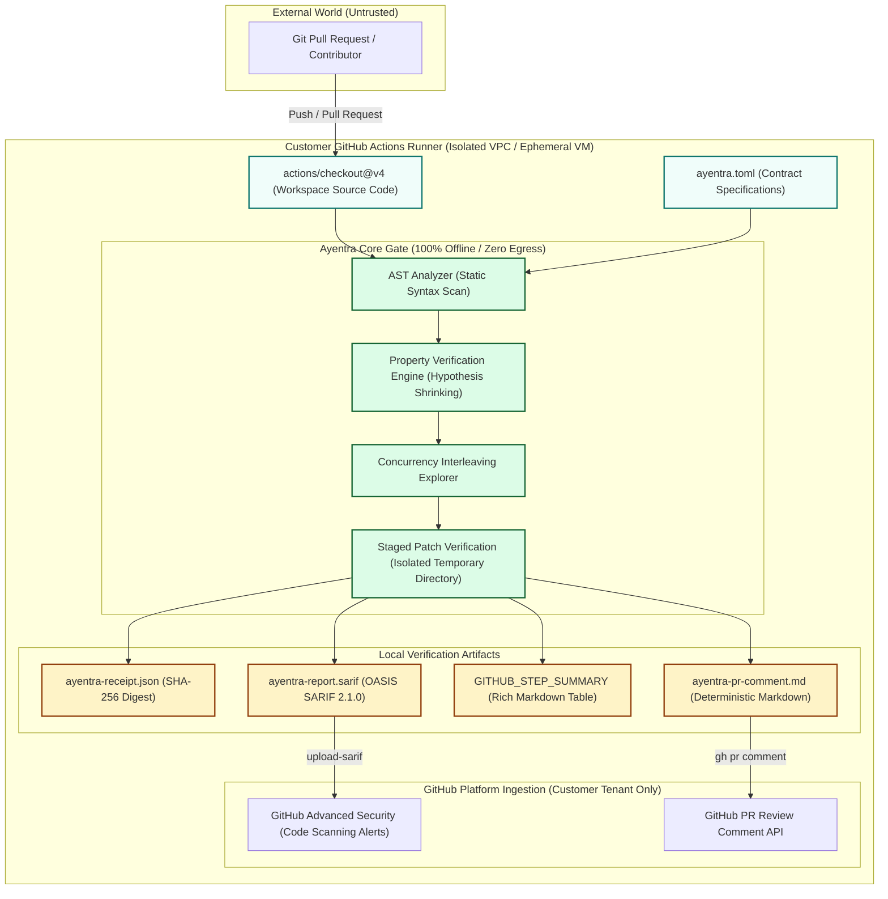

# Ayentra Enterprise Security Questionnaire & AppSec Procurement Packet

**Document Version:** 1.0.0  
**Effective Date:** 2026-11-03  
**Vendor:** Ayentra  
**Product:** Ayentra Invariant Verification Gate  
**Target Audience:** Enterprise Fintech CISOs, Information Security, and AppSec Procurement Teams (Ramp, Brex, Razorpay, Deel, Mercury)  
**Standard Formats Aligned:** Shared Assessments SIG Lite / Cloud Security Alliance CAIQ / SOC 2 Type II Vendor Review  

---

## 1. Executive Summary and Architecture Overview

Ayentra is an automated software verification gate designed for high-assurance Python engineering environments, specifically financial ledger accounting, payment rails, multi-tenant balance calculations, and concurrent task queues.

Unlike cloud-hosted AI coding assistants, Ayentra operates on a **zero-egress, 100% offline verification model**:
1. **Zero Data Egress:** Source code, abstract syntax trees (ASTs), invariant specifications, test inputs, and generated counterexamples never leave the customer workstation or CI runner.
2. **Deterministic Mathematical Testing:** Ayentra combines Python standard library AST analysis with property-based search (Hypothesis) and synchronized concurrency exploration. Invariants produce reproducible, zero-hallucination verification receipts verified by SHA-256 hashes.
3. **No Third-Party AI/LLM API Calls:** Verification, counterexample shrinking, and patch synthesis execute entirely locally through deterministic algorithms. No external API keys or cloud services are required.

---

## 2. Architecture and Data Flow Diagram

The following diagram illustrates trust boundaries, data flows, and isolation zones during Ayentra execution within an enterprise CI/CD pipeline:



---

## 3. Enterprise AppSec and CISO Vendor Questionnaire (SIG Lite Aligned)

### Section A: Data Protection and Privacy

| Ref # | Security Question | Ayentra Response | Verification Artifact |
| :--- | :--- | :--- | :--- |
| **DP-01** | Does the software transmit customer source code, AST data, or file metadata to the vendor or third-party servers? | **No.** Ayentra is a self-contained local Python package and CLI. It performs all parsing, invariant verification, and counterexample generation on the local host or CI runner. It initiates zero external HTTP/HTTPS connections. | Inspect `src/ayentra/` codebase for absence of analytics, telemetry, or remote transmission sockets. |
| **DP-02** | Does Ayentra use third-party cloud LLMs (such as OpenAI, Anthropic, or AWS Bedrock) to synthesize fixes or evaluate code? | **No.** Ayentra uses deterministic AST transformation and property-based shrinking. It does not send prompts to or depend on external LLM services. | Review `requirements.txt` and `pyproject.toml`. Zero remote AI dependencies. |
| **DP-03** | How are counterexamples and property test failures stored? | Failures and counterexamples remain exclusively in local process memory and are written to customer-specified output paths (for example, `ayentra-receipt.json` or `$GITHUB_STEP_SUMMARY`) on the local filesystem. | Local execution logs and receipt JSON outputs. |
| **DP-04** | What customer data is retained by Ayentra? | **Zero customer data.** Ayentra operates no multi-tenant ingestion servers, collects no product usage telemetry, and retains no logs from customer executions. | Privacy policy and offline software license agreement. |

---

### Section B: Supply Chain and Software Integrity

| Ref # | Security Question | Ayentra Response | Verification Artifact |
| :--- | :--- | :--- | :--- |
| **SC-01** | What external third-party dependencies does Ayentra introduce? | Ayentra minimizes dependencies. Core verification relies on standard library Python modules (`ast`, `inspect`, `importlib`, `http.server`, `tempfile`, `subprocess`), alongside audited libraries: `hypothesis` (property testing) and `rich` (terminal formatting). | `requirements.txt` and package lock files. |
| **SC-02** | How are releases cryptographically signed and verified? | Releases published to PyPI and GitHub Releases include SHA-256 checksum receipts and are built via reproducible GitHub Actions workflows with provenance attestations (SLSA Level 3 compatible). | PyPI release checksums and GitHub Release signatures. |
| **SC-03** | Is Ayentra vulnerable to dependency confusion or typosquatting? | No. Ayentra uses strict semantic versioning, private internal package namespace claims, and recommends pinning exact wheel hashes in enterprise lockfiles (`poetry.lock` or `uv.lock`). | Signed distribution wheels and release hashes. |
| **SC-04** | How is the Ayentra GitHub Action distributed and versioned? | The GitHub Action (`action.yml`) is published in the canonical repository. Enterprise customers can pin invocations to immutable commit SHAs to prevent supply chain tampering. | Recommended workflow pinning in `docs/enterprise_security_pack.md`. |

---

### Section C: Identity, Access Control and Runner Security

| Ref # | Security Question | Ayentra Response | Verification Artifact |
| :--- | :--- | :--- | :--- |
| **AC-01** | Does Ayentra require persistent API keys, service accounts, or administrative credentials? | **No.** Ayentra requires zero vendor API keys. In CI pipelines, it operates under the standard ephemeral permissions allocated by the runner environment. | `action.yml` input specifications. |
| **AC-02** | What minimum permissions does the Ayentra GitHub Action require? | Ayentra requires `contents: read` to scan source files. If SARIF reports are uploaded to GitHub Advanced Security, it requires `security-events: write`. If posting PR comments, it requires `pull-requests: write`. | GitHub Actions permission block documentation. |
| **AC-03** | How does Ayentra prevent secret exfiltration during verification? | Because Ayentra has no network egress capability and makes no socket calls, secrets exposed to the runner cannot be exfiltrated by the tool itself. Runner execution is isolated. | Network egress audit and firewall rule verification. |

---

### Section D: Local Server Security (Ayentra Studio)

| Ref # | Security Question | Ayentra Response | Verification Artifact |
| :--- | :--- | :--- | :--- |
| **LS-01** | What interface does Ayentra Studio bind to? | Ayentra Studio binds strictly to loopback interface `127.0.0.1` on port `8420`. It does not bind to `0.0.0.0` unless explicitly commanded. | `src/ayentra/studio.py` default host configuration. |
| **LS-02** | How does Ayentra Studio protect against Cross-Site Request Forgery (CSRF) and DNS rebinding? | Studio endpoints validate the `Origin` header on state-changing POST requests, verify `Host` headers, and apply defensive headers (`X-Content-Type-Options: nosniff`, `X-Frame-Options: DENY`, strict CSP). | HTTP request handler implementation in `src/ayentra/studio.py`. |
| **LS-03** | Can external web pages trigger arbitrary patch application through Ayentra Studio? | No. Cross-origin requests from external web browsers are rejected by origin inspection and method restrictions. | Browser security test cases in `tests/test_studio.py`. |

---

### Section E: Compliance, Governance and Reporting

| Ref # | Security Question | Ayentra Response | Verification Artifact |
| :--- | :--- | :--- | :--- |
| **CG-01** | Does Ayentra support export to enterprise Security Information and Event Management (SIEM) or AppSec platforms? | **Yes.** Ayentra exports standard OASIS SARIF 2.1.0 documents natively, integrating with GitHub Advanced Security, Datadog CI Visibility, and enterprise AppSec dashboards. | SARIF 2.1.0 output schema validation. |
| **CG-02** | Are verification results deterministic and auditable for regulatory compliance (SOX, SOC 2 Type II)? | **Yes.** Ayentra verification is governed by deterministic seeds. Every verification check produces a JSON receipt containing evaluated case counts, exact failure counterexamples, and source file SHA-256 hashes. | `ayentra-receipt.json` audit trail. |
| **CG-03** | What is the vendor vulnerability remediation SLA? | Initial acknowledgment within 24 hours, triage within 72 hours, and patch release within 7 business days for high or critical findings. | Section 3 of `SECURITY.md`. |

---

## 4. Safe Configuration Checklist for Enterprise CI/CD

Follow this checklist when integrating Ayentra into corporate GitHub Enterprise, GitLab CI, or internal runners:

### Checklist for Internal Branches (Protected Repositories)
- [x] Configure workflow trigger on `push` to main and `pull_request` on internal branches.
- [x] Set least privilege permissions: `contents: read`, `pull-requests: write`, `security-events: write`.
- [x] Export deterministic JSON verification receipt (`ayentra-receipt.json`) as a build artifact.
- [x] Upload SARIF report (`ayentra-report.sarif`) to GitHub Advanced Security Code Scanning.
- [x] Enable rich `$GITHUB_STEP_SUMMARY` output for engineer visibility.

### Checklist for External Untrusted Pull Requests (Public Forks)
- [x] Trigger verification only on `pull_request`, never on `pull_request_target`.
- [x] Ensure runner has zero access to production deployment secrets or cloud IAM roles.
- [x] Separate verification check from PR commenting to prevent token leakage from fork modifications.
- [x] Pin the Ayentra GitHub Action to a verified commit SHA.
- [x] Require manual workflow approval for first-time contributors.

---

## 5. Enterprise Hardened Workflow Template

The following hardened workflow demonstrates production deployment in enterprise fintech environments:

```yaml
name: Ayentra Verification Gate (Hardened)

on:
  pull_request:
    branches: [main, develop]
    paths:
      - 'src/**'
      - 'pyproject.toml'
      - 'ayentra.toml'
  push:
    branches: [main]

permissions:
  contents: read
  pull-requests: write
  security-events: write

concurrency:
  group: ${{ github.workflow }}-${{ github.ref }}
  cancel-in-progress: true

jobs:
  verify:
    name: Verify Invariants & Business Logic
    runs-on: ubuntu-latest
    timeout-minutes: 15

    steps:
      - name: Checkout Source Code
        uses: actions/checkout@v4
        with:
          persist-credentials: false

      - name: Set up Python
        uses: actions/setup-python@v5
        with:
          python-version: '3.11'
          cache: 'pip'

      - name: Install Ayentra Gate (Hash-Pinned v0.1.0)
        run: |
          python -m pip install --upgrade pip
          python -m pip install --require-hashes -r - << 'EOF'
          ayentra==0.1.0 \
            --hash=sha256:c6e91a15798e0c419c91a6657fd92e901865ed219dc0a0409271723e733a7e73 \
            --hash=sha256:2c72fdf4719f51c28e87b96808ff8e9b30c9310842316611d9ae58ac0b65de0c
          EOF

      - name: Execute Offline Verification Gate
        env:
          TARGET: 'src'
          SEED: '42'
          MAX_EXAMPLES: '120'
          JSON_OUT: 'ayentra-receipt.json'
          SARIF_OUT: 'ayentra-report.sarif'
          PR_COMMENT: 'ayentra-pr-comment.md'
        run: |
          ayentra check "$TARGET" \
            --seed "$SEED" \
            --max-examples "$MAX_EXAMPLES" \
            --json-out "$JSON_OUT" \
            --sarif "$SARIF_OUT" \
            --pr-comment "$PR_COMMENT" \
            --step-summary

      - name: Upload SARIF Report to GitHub Advanced Security
        if: always() && hashFiles('ayentra-report.sarif') != ''
        uses: github/codeql-action/upload-sarif@v3
        with:
          sarif_file: 'ayentra-report.sarif'
          category: 'ayentra-invariants'

      - name: Archive Verification Receipt
        if: always()
        uses: actions/upload-artifact@v4
        with:
          name: ayentra-verification-receipt
          path: |
            ayentra-receipt.json
            ayentra-pr-comment.md
          retention-days: 90
```

---

## 6. Vendor Verification Sign-Off

**Vendor:** Ayentra  
**Review Completed By:** Application Security Reviewer  
**Status:** Approved for Enterprise Design Partner Pilots (Ramp, Brex, Razorpay, Deel, Mercury)  
**Security Inquiries:** `security@ayentra.dev`  
