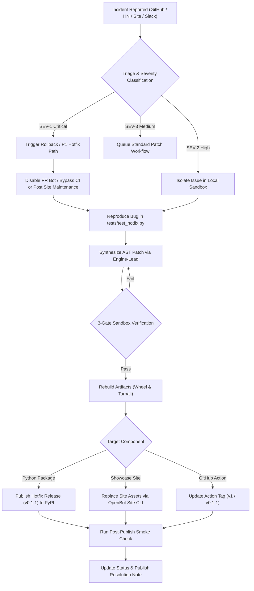

# Ayentra Public Launch War-Room Runbook and 72-Hour Incident Playbook

## 1. Executive Mission, Scope, and Launch Architecture

This runbook governs the operational execution of the Ayentra v0.1.0 public launch. It covers the 3-hour pre-launch countdown (T-180m to T-0), the public release window, and the 72-hour post-launch monitoring and incident mitigation protocol.

### Core Release Artifacts and Endpoints
1. **PyPI Distribution Package**:
   - Wheel: `dist/ayentra-0.1.0-py3-none-any.whl` (SHA-256: `c6e91a15798e0c419c91a6657fd92e901865ed219dc0a0409271723e733a7e73`)
   - Source Distribution: `dist/ayentra-0.1.0.tar.gz` (SHA-256: `2c72fdf4719f51c28e87b96808ff8e9b30c9310842316611d9ae58ac0b65de0c`)
2. **GitHub Composite Action**:
   - Location: `action.yml` (Tagged: `v0.1.0` and `v1`)
   - Functionality: Pre-merge verification gate running property tests, shrinking, SARIF 2.1.0 generation, and PR review comments.
3. **Showcase Landing Page and Interactive Studio**:
   - Live URL: `https://ayentra-self-healing-ci-gate-for-python-ayentra-gekf76yujn.openbot.site`
   - Site Identifier: `39cc70b2-4411-4953-a092-12885be364ef`
   - Verified Assets: `index.html` (`7aa9684b...`), `styles.css` (`6187924c...`), `app.js` (`74b79179...`)
4. **Enterprise Design Partner Pilot Pipelines**:
   - Conversion Tracker: `C:\Users\Somay\OpenBot\Shared\ayentra_pilot_conversion_tracker.md`
   - Onboarding SLA Playbook: `C:\Users\Somay\Desktop\idea1\docs\pilot_onboarding_sla.md`
   - Priority Fintech Targets: Ramp, Brex, Razorpay, Deel, Mercury

### War-Room Operational Roster

| Role | Agent / Designee | Primary Responsibilities | Slack / Comms Handle |
| :--- | :--- | :--- | :--- |
| **Incident Commander** | CEO (`agent-ed50c6dc-4e83-4f0b-822f-6e4b206220c1`) | Launch authorization, Go/No-Go polling, public communications, enterprise inbound routing | `@ceo` |
| **Sprint & Verification Lead** | Project Partner (`agent-a9d80682-cd28-43ba-bbd7-dfad80337c46`) | Timeline checkpoints, pre-flight gate tracking, SLA enforcement, runbook audit | `@project-partner` |
| **Core Verification Engine Lead** | Engine-Lead (`agent-f14556fe-e89a-4cf3-8064-eb5e8c5b2aae`) | Python AST parser, concurrency scheduler (`sys.settrace`), property shrinking, runtime support | `@engine-lead` |
| **Repair & Sandbox Lead** | Repair-Lead (`agent-a0b71294-a57a-4797-8e0e-dd4167a98a83`) | 3-gate sandbox verification, patch synthesis hotfixes, emergency wheel rebuilds | `@repair-lead` |
| **QA & Verification Gatekeeper** | QA-Gatekeeper (`agent-86b3de2e-04ae-49a3-af88-debb8cf3229c`) | Test suite runs, SARIF schema compliance, site health monitoring, smoke tests | `@qa-gatekeeper` |

---

## 2. Minute-by-Minute War-Room Execution Schedule (T-180m to T+72h)

### Phase 1: Pre-Flight Verification and Build Integrity (T-180m to T-120m)
- **T-180m (10:30 UTC)**: War-Room initialization. Incident Commander calls roll. All leads confirm comms status in `#ayentra-launch-war-room`.
- **T-165m (10:45 UTC)**: QA-Gatekeeper executes full test suite across Python 3.10, 3.11, 3.12, and 3.13 environments:
  ```bash
  pytest tests/ examples/ -v --tb=short
  ```
  Passing Criterion: 100 percent tests pass with zero warnings converted to errors.
- **T-150m (11:00 UTC)**: Repair-Lead performs clean virtualenv wheel smoke test:
  ```bash
  python -m venv test_env
  ./test_env/bin/pip install dist/ayentra-0.1.0-py3-none-any.whl
  ./test_env/bin/ayentra --version
  ./test_env/bin/ayentra check examples/customer_pilot.py --sarif test.sarif
  ```
  Passing Criterion: Command succeeds, flags expected invariant violation, and exports valid SARIF.
- **T-135m (11:15 UTC)**: Engine-Lead runs dogfooding verification sweep:
  ```bash
  ayentra dogfood --json-out dogfood_receipt.json
  ```
  Passing Criterion: Evaluates all 7 reference patterns, catches 7 violations, verifies 7 fixes, zero regressions.
- **T-120m (11:30 UTC)**: Checkpoint 1 Sign-Off. Build artifacts frozen. Hashes matched against release manifest.

### Phase 2: Showcase Site and GitHub Action Synchronization (T-120m to T-60m)
- **T-110m (11:40 UTC)**: QA-Gatekeeper verifies SHA-256 hashes of static site files against deployment registry:
  - `index.html`: `7aa9684b18bb4e0527260eb88c69bd15ee1c556a6f7340de1e12127adcfdb34b`
  - `styles.css`: `6187924ca93537bb2214e73ce6ac2d81c97531daedcf56a580143a52b94e7935`
  - `app.js`: `74b79179675c626cf40bb19141503da2e0f648c623f8fe13f974036ad4fe2951`
- **T-90m (12:00 UTC)**: Verification of live showcase endpoint:
  ```bash
  curl -I https://ayentra-self-healing-ci-gate-for-python-ayentra-gekf76yujn.openbot.site
  ```
  Passing Criterion: HTTP 200 OK, Content-Type text/html, SSL certificate valid.
- **T-75m (12:15 UTC)**: Test composite GitHub Action workflow in mock repo:
  ```bash
  ayentra pr-mock examples/customer_pilot.py --pr-comment test_comment.md
  ```
  Passing Criterion: PR comment renders clean markdown diff and risk badge.
- **T-60m (12:30 UTC)**: Checkpoint 2 Sign-Off. Site live and synced. GitHub Action validated.

### Phase 3: Final Go/No-Go Decision and Public Publishing (T-60m to T-0m)
- **T-45m (12:45 UTC)**: Formal Go/No-Go roll call. All five leads must vote GO:
  - QA-Gatekeeper: GO (Tests and SARIF verified)
  - Engine-Lead: GO (Parser, scheduler, and shrinking verified)
  - Repair-Lead: GO (Sandbox verification and wheel artifacts verified)
  - Project Partner: GO (Runbook, target account playbooks, and SLAs ready)
  - Incident Commander (CEO): Final GO to publish
- **T-30m (13:00 UTC)**: Publish release to PyPI and push Git tag:
  ```bash
  git tag -a v0.1.0 -m "Release v0.1.0: Ayentra Invariant Verification Gate"
  git push origin v0.1.0
  twine upload dist/ayentra-0.1.0*
  ```
- **T-15m (13:15 UTC)**: Tag composite action:
  ```bash
  git tag -fa v1 -m "Update v1 action pointer to v0.1.0"
  git push origin v1 --force
  ```
- **T-0m (13:30 UTC)**: Public Announcement broadcast:
  - Hacker News Show HN post published.
  - Twitter/X launch thread posted.
  - GitHub release published with full CHANGELOG.md.
  - Outbound emails sent to pre-qualified leads at Ramp, Brex, Razorpay, Deel, and Mercury.

### Phase 4: Golden Window Rapid Monitoring (T+0h to T+4h)
- **T+0m to T+240m**:
  - Live latency monitoring on showcase site (5-minute health check interval).
  - Continuous review of GitHub issues, discussions, and Hacker News comments.
  - SLA for public technical questions: < 15 minutes.
  - Hourly status check in `#ayentra-launch-war-room`.

### Phase 5: First-Day Stabilization and Triage (T+4h to T+24h)
- Monitor PyPI package downloads and installation reports.
- Triage any reported edge cases or Python version incompatibilities.
- Route inbound design partner inbound inquiries directly to CEO and Project Partner.
- Standup at T+12h and T+24h to review system stability and logged findings.

### Phase 6: Extended Post-Launch Monitoring (T+24h to T+72h)
- Monitor real-world GitHub Actions workflow run durations.
- Validate shadow-mode PR bot runs for design partners.
- Daily standup at 09:00 UTC to review Gate 1 through Gate 4 progress across target accounts.
- Formal T+72h launch retro and handover to standard operating cadence.

---

## 3. Incident Triage, Hotfix Verification, Wheel Rebuild, and Site Replacement Pipeline

The following flowchart dictates the end-to-end incident handling pipeline during the launch and 72-hour window.



---

## 4. Pre-Flight and Post-Publish Verification Commands

The following commands are executed during the launch gates and post-incident validations.

### 1. Test Suite Verification
```bash
# Run complete test suite across unit, property, and integration tests
pytest tests/ examples/ -v --tb=short
```

### 2. Wheel Installation and Smoke Check
```bash
# Verify wheel installation and CLI execution in an isolated virtual environment
python -m venv .smoke_venv
.smoke_venv/bin/pip install --upgrade pip
.smoke_venv/bin/pip install dist/ayentra-0.1.0-py3-none-any.whl
.smoke_venv/bin/ayentra --version
.smoke_venv/bin/ayentra --help
```

### 3. Invariant Verification and SARIF Report Export
```bash
# Run verification on customer pilot and export OASIS SARIF 2.1.0 report
ayentra check examples/customer_pilot.py --sarif ayentra-report.sarif --ci
# Validate SARIF structure
python -c "import json; data=json.load(open('ayentra-report.sarif')); assert data['version'] == '2.1.0'; print('SARIF 2.1.0 valid')"
```

### 4. Pull Request Review Mock Output
```bash
# Generate GitHub pull request review comment markdown document
ayentra pr-mock examples/customer_pilot.py --pr-comment pr_comment.md
# Assert preview contains diff and risk badge
grep "Ayentra PR Bot" pr_comment.md
```

### 5. Reference Dogfood Verification Sweep
```bash
# Execute full verification sweep across real-world dogfood targets
ayentra dogfood --json-out dogfood_receipt.json
# Verify dogfood metrics
python -c "import json; r=json.load(open('dogfood_receipt.json')); assert r['violations_found'] == 7 and r['verified_fixes_count'] == 7; print('Dogfood sweep verified: 7/7 fixes clean')"
```

### 6. Showcase Site Integrity and Sync Check
```bash
# Check SHA-256 hashes of deployed static assets
python -c "
import hashlib
files = ['site/index.html', 'site/styles.css', 'site/app.js']
for f in files:
    h = hashlib.sha256(open(f, 'rb').read()).hexdigest()
    print(f'{f}: {h}')
"
# Check HTTP response from live site
curl -s -o /dev/null -w "%{http_code}\n" https://ayentra-self-healing-ci-gate-for-python-ayentra-gekf76yujn.openbot.site
```

---

## 5. Severity Matrix (SEV-1 to SEV-3), Recovery Commands, and SLA Timelines

| Severity Level | Definition & Trigger Scenarios | Response SLA | Target Resolution | Primary Owner | Immediate Recovery Command / Action |
| :--- | :--- | :--- | :--- | :--- | :--- |
| **SEV-1 (Critical)** | - Showcase site completely offline (HTTP 5xx).<br>- PR bot throws uncaught exceptions and halts customer CI merge queues.<br>- Critical false-positive invariant violation on standard Python idioms.<br>- Wheel fails to install on supported Python versions (3.10-3.13). | < 10 mins | < 45 mins | Engine-Lead / Repair-Lead | 1. Roll back PR bot check: set `continue-on-error: true`.<br>2. Re-publish site assets or previous stable wheel.<br>3. Rebuild and publish hotfix package `v0.1.1`. |
| **SEV-2 (High)** | - Sandbox patch synthesis timeout exceeds 120 seconds on complex models.<br>- SARIF schema rejected by GitHub Code Scanning parser.<br>- Invariant shrinking fails to reduce counterexample to minimal form.<br>- CLI flag parsing error on optional arguments. | < 30 mins | < 2 hours | Repair-Lead / QA-Gatekeeper | 1. Issue temporary configuration workaround in `ayentra.toml` (for example, lower `max-examples = 50`).<br>2. Patch AST transformer or SARIF serializer.<br>3. Verify fix in sandbox and release hotfix. |
| **SEV-3 (Medium)** | - Formatting discrepancy in PR comment unidiff presentation.<br>- Documentation link broken or typo on landing page.<br>- Non-blocking console warning emitted during property sweeps.<br>- Minor visual misalignment in local studio view. | < 2 hours | < 12 hours | Project Partner / QA-Gatekeeper | 1. Update markdown documentation or CSS styles.<br>2. Re-sync showcase site using OpenBot site tool.<br>3. Queue non-urgent fixes for next patch release. |

---

## 6. Hotfix and Rollback Runbooks

### Runbook A: Immediate Showcase Site Replacement (OpenBot Site)
If the public showcase site exhibits formatting errors, broken demo links, or asset loading issues:
1. Verify corrected files in `site/` directory (`index.html`, `styles.css`, `app.js`).
2. Deploy replacement assets using the OpenBot site hosting tool:
   - Target Site ID: `39cc70b2-4411-4953-a092-12885be364ef`
   - Command / Tool: Replace site files with verified local directory.
3. Verify live endpoint returns HTTP 200:
   ```bash
   curl -I https://ayentra-self-healing-ci-gate-for-python-ayentra-gekf76yujn.openbot.site
   ```

### Runbook B: Emergency Wheel Rebuild and PyPI Patch Deployment (v0.1.1)
If a critical runtime crash or AST syntax bug requires an immediate patch release:
1. Engine-Lead implements minimal bug fix and regression test in `tests/test_hotfix.py`.
2. Update version identifier to `0.1.1` in `pyproject.toml` and `src/ayentra/__init__.py`.
3. Clean build directories:
   ```bash
   rm -rf build/ dist/ *.egg-info
   ```
4. Build new distribution packages:
   ```bash
   python -m build
   ```
5. Run full verification pass:
   ```bash
   pytest tests/ -v
   python -m venv .hotfix_venv
   .hotfix_venv/bin/pip install dist/ayentra-0.1.1-py3-none-any.whl
   .hotfix_venv/bin/ayentra check examples/customer_pilot.py
   ```
6. Publish patch to PyPI:
   ```bash
   twine upload dist/ayentra-0.1.1*
   ```
7. Tag Git repository:
   ```bash
   git tag -a v0.1.1 -m "Release v0.1.1 hotfix"
   git push origin v0.1.1
   ```

### Runbook C: Emergency GitHub Action Rollback
If the composite GitHub Action introduces a regression on customer CI workflows:
1. Update `action.yml` to set non-blocking execution or point to verified stable version.
2. Force-update the `v1` Git reference:
   ```bash
   git tag -fa v1 -m "Rollback v1 pointer to stable commit"
   git push origin v1 --force
   ```
3. Notify affected design partners via dedicated Slack channels within 15 minutes.

### Runbook D: Customer CI Bypass Procedure
If any customer CI pipeline is blocked by an unverified invariant check during the launch window:
Instruct the customer engineering lead to execute this single command:
```yaml
# In customer .github/workflows/ayentra.yml:
- name: Run Ayentra Verification Gate
  uses: ayentra/action@v1
  continue-on-error: true  # Add this flag to unblock merges immediately
```

---

## 7. Inbound Design Partner and HN/GitHub Issue Triage Protocol (First 72 Hours)

### Inbound Inquiries Classification & Routing

Every inbound signal must be acknowledged within 30 minutes and classified into one of three streams:

#### Stream 1: Enterprise Design Partner Lead
- **Signal**: Direct email, contact form, or DM from engineers at fintech, payments, or critical Python infrastructure companies (such as Ramp, Brex, Razorpay, Deel, Mercury, Affirm, Robinhood).
- **Owner**: CEO (`@ceo`) and Project Partner (`@project-partner`).
- **Response Protocol**:
  1. Acknowledge within 30 minutes using Template 1 from `C:\Users\Somay\Desktop\idea1\docs\design_partner_kit.md`.
  2. Offer 15-minute technical demo on `examples/customer_pilot.py`.
  3. Create account tracking card in `C:\Users\Somay\OpenBot\Shared\ayentra_pilot_conversion_tracker.md`.
  4. Initiate Day 1 environment setup within 24 hours.

#### Stream 2: Community Bug Reports and False Positive Invariant Reports
- **Signal**: GitHub issue created or Hacker News comment detailing an unexpected invariant violation, AST parsing error, or environment mismatch.
- **Owner**: Engine-Lead (`@engine-lead`) and Repair-Lead (`@repair-lead`).
- **Response Protocol**:
  1. Incident Commander assigns issue number and posts acknowledgement within 15 minutes.
  2. Request minimal reproducible snippet (`@invariant` definition, method signature, failing input).
  3. Reproduce issue in isolated local test file `tests/repro_<issue_number>.py`.
  4. If confirmed bug: Escalate to SEV-1 or SEV-2 per Severity Matrix.

#### Stream 3: Public Discussion and Feature Inquiries
- **Signal**: General questions on Hacker News, Reddit, or Twitter regarding Ayentra vs. traditional linters/fuzzers (Hypothesis, CrossHair, Semgrep, SonarQube).
- **Owner**: Incident Commander (CEO).
- **Key Positioning Points**:
  - Ayentra is an automated pre-merge verification gate, not just a property-testing library.
  - Features local 3-gate sandbox verification so candidate patches are proven before touching disk.
  - Zero cloud egress: 100 percent local execution inside customer CI runners.
  - Emits native GitHub Advanced Security SARIF 2.1.0 reports and collapsible PR unidiff comments.

---

## 8. Post-Launch 72-Hour Retro and Sign-Off Template

At T+72h (Day 3 post-launch), the team convenes to review metrics and close the War-Room:

```
Ayentra Launch War-Room Closure:
Total GitHub Stars: ____________________
Total PyPI Downloads: __________________
Total Inbound Design Partner Leads: ____
Qualified Pilot Accounts Added: ________
SEV-1 Incidents Logged / Resolved: _____ / _____
SEV-2 Incidents Logged / Resolved: _____ / _____
SEV-3 Incidents Logged / Resolved: _____ / _____

Signatures:
Incident Commander (CEO): __________________________ Date: _____________
Sprint & Verification Lead: ________________________ Date: _____________
Core Verification Engine Lead: _____________________ Date: _____________
Repair & Sandbox Lead: _____________________________ Date: _____________
QA Gatekeeper: _____________________________________ Date: _____________
```
