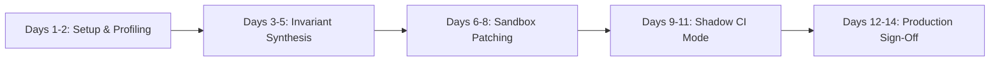

# Enterprise Design Partner: 14-Day Pilot Onboarding and Service Level Agreement (SLA) Playbook

## 1. Executive Purpose, Scope, and Enterprise SLA Commitments

This document establishes the technical onboarding framework, support service levels, and data security boundaries for enterprise design partners participating in the Ayentra 14-day verification pilot.

### Core Objectives
1. Verify mission-critical business invariants in customer Python services before code merges to production.
2. Provide deterministic, sandbox-verified code fixes for detected invariant counterexamples.
3. Establish non-blocking pre-merge verification in GitHub Actions CI with zero developer friction.
4. Convert design partner evaluations into annual enterprise production agreements.

### Support Response SLAs

Ayentra provides dedicated engineering support throughout the 14-day pilot engagement under the following Service Level Agreement:

| Severity Level | Definition | Initial Response SLA | Target Resolution SLA | Primary Ayentra Contact |
| :--- | :--- | :--- | :--- | :--- |
| **P1 - Critical** | CI pipeline disruption, merge blocker, or false positive halting PR workflows | < 15 minutes (24/7) | < 2 hours | Engine-Lead / On-Call Engineer |
| **P2 - High** | Sandbox patch synthesis failure, invariant specification bug, or runtime incompatibility | < 1 hour (Business hours) | < 6 hours | Repair-Lead |
| **P3 - Medium** | SARIF export configuration, reporting discrepancies, or performance optimization | < 4 hours (Business hours) | < 24 hours | QA-Gatekeeper |
| **P4 - Low** | Invariant modeling guidance, documentation queries, or feature requests | < 1 business day | Agreed roadmap | Project Partner |

### Security and Data Privacy Guarantees
- **Zero Code Egress**: Ayentra operates 100 percent locally on customer hardware or customer-managed CI runners (for example, GitHub Actions self-hosted or standard runners).
- **No External Network Dependencies**: Source code, Abstract Syntax Trees (AST), domain models, and financial data are never transmitted to external cloud servers, model providers, or third-party endpoints.
- **Air-Gapped Operation**: Ayentra performs invariant shrinking, concurrency scheduling, and sandbox patch verification entirely inside local process boundaries.
- **Local Receipt Generation**: All verification receipts (`ayentra-receipt.json`) and security reports (`ayentra-report.sarif`) remain inside the customer repository workspace.

---

## 2. 14-Day Technical Onboarding Architecture

The pilot progresses through five distinct phases over 14 calendar days, tracked against concrete acceptance gates.



### Phase Schedule Breakdown

#### Days 1-2: Environment Setup and Baseline Invariant Profiling
- **Actions**: Install Ayentra in the target development environment; run `ayentra init --ci` to generate base configuration (`ayentra.toml`) and CI workflows.
- **Deliverables**: Verified local installation; initial AST profiling report of target repository modules.
- **Customer Time Commitment**: 45 minutes (DevSecOps or Staff Engineer).

#### Days 3-5: Invariant Synthesis and Gate 1 Execution
- **Actions**: Define explicit domain contracts on core financial models (ledger balance conservation, non-negative amounts, state machine bounds). Execute `ayentra check` to identify minimal counterexamples.
- **Deliverables**: Identification of first valid domain invariant violation; generated SARIF 2.1.0 scan report.
- **Customer Time Commitment**: 2 hours (Domain Engineering Lead).

#### Days 6-8: Sandbox Patch Verification and Gate 2 Sign-Off
- **Actions**: Ayentra synthesizes candidate patches in an isolated sandbox. Execute the 3-gate regression verification suite.
- **Deliverables**: `ayentra-receipt.json` documenting counterexample replay success, 120-vector property sweep, and clean pytest regression pass.
- **Customer Time Commitment**: 1 hour (Code Review Lead / Staff Engineer).

#### Days 9-11: CI/CD Pipeline Integration and Gate 3 Shadow Mode
- **Actions**: Merge `.github/workflows/ayentra.yml` in shadow mode (`continue-on-error: true`). Observe PR Bot review comments across active pull requests.
- **Deliverables**: Five consecutive pull request runs with zero false alarms and execution time under 90 seconds.
- **Customer Time Commitment**: 30 minutes asynchronous review.

#### Days 12-14: Audit Review, Executive Readout, and Gate 4 Commercial Conversion
- **Actions**: Present formal verification audit findings and ROI summary to VP of Engineering and Finance stakeholders. Finalize production subscription terms.
- **Deliverables**: Signed Enterprise Order Form and Master Services Agreement.
- **Customer Time Commitment**: 45 minutes (VP of Engineering / Procurement).

---

## 3. Conversion Gate Verification Protocol

Progress through the pilot is strictly gated by measurable technical milestones.

### Gate 1: First Real Repository Invariant Violation Caught
- **Standard**: Ayentra must uncover an edge-case invariant violation in existing repository code that passed current unit test suites.
- **Verification Command**:
  ```bash
  ayentra check <target_module>.py --ci --sarif ayentra-report.sarif
  ```
- **Acceptance Criteria**:
  1. Identifies an input vector violating an explicit `@invariant` contract.
  2. Demonstrates input shrinking to the minimal reproducible counterexample.
  3. Produces valid OASIS SARIF 2.1.0 output with rule ID `AYENTRA001`.

### Gate 2: Deterministic Sandbox Patch Verified Across 3-Gate Regression Check
- **Standard**: Ayentra must synthesize a candidate fix and deterministically prove correctness inside a temporary isolated sandbox before disk modification.
- **The 3-Gate Sandbox Verification Protocol**:
  1. *Check 1 (Counterexample Replay)*: Executes the exact shrunk counterexample against the patched AST. Must cleanly prevent balance corruption or throw designated domain exceptions.
  2. *Check 2 (120-Vector Property Sweep)*: Executes 120 pseudo-randomized property test inputs across configured domain ranges (`@domain` limits). Invariant must hold across all 120 vectors.
  3. *Check 3 (Full Pytest Regression Suite)*: Runs the repository complete pytest test suite in an isolated virtual environment. Zero test failures or regressions permitted.
- **Verification Command**:
  ```bash
  ayentra verify-patch <target_module>.py --patch-receipt ayentra-receipt.json
  ```
- **Acceptance Criteria**:
  - `ayentra-receipt.json` contains:
    - `"sandbox_status": "VERIFIED CANDIDATE FIX"`
    - `"counterexample_replay": "PASS"`
    - `"property_sweep_120": "PASS"`
    - `"pytest_regression": "PASS"`

### Gate 3: GitHub Actions PR Bot Deployed in Shadow Mode
- **Standard**: Automated PR comments generated without interrupting existing developer velocity.
- **Verification Command**:
  ```bash
  ayentra pr-mock <target_module>.py --pr-comment pr_review.md
  ```
- **Acceptance Criteria**:
  1. Posts clear pull request comment containing plain-English risk description, minimal failing inputs, collapsible unidiff preview, and one-click apply instructions.
  2. Completes PR checks in under 90 seconds.
  3. Zero false positives across 5 consecutive active pull requests.

### Gate 4: Annual Commercial Contract Sign-Off
- **Standard**: Transition to annual enterprise production contract.
- **Commercial Package Options**:
  - *Tier 1 Enterprise Core* ($120,000/year): Unlimited repositories, full AST concurrency race scheduler, custom domain generator plugins, 15-minute dedicated Slack support.
  - *Tier 2 Growth* ($60,000/year): Up to 10 repositories, automated sandbox patch verification, GitHub SARIF integration, 1-hour support SLA.
  - *Tier 3 Team* ($40,000/year): Up to 3 critical service repositories, pre-merge invariant gate, standard 4-hour support SLA.

---

## 4. Target Account Implementation Blueprints

The following blueprints define repository targets, scope boundaries, and acceptance criteria for our 5 priority fintech partners.

### Blueprint 1: Ramp
- **Organization**: Ramp Business Corporation
- **Target Repository**: Core Python Payments Monolith (`core/payments/`)
- **Key Modules**: `TransferCanonical`, `ACHDetails`, `hold_in_escrow`
- **Scope Boundary**: In-scope: Python payment models, Celery async task dispatch, balance invariants. Out-of-scope: Frontend React applications, external bank APIs.
- **Sample Configuration (`ayentra.toml`)**:
  ```toml
  [workspace]
  root = "core/payments"
  python_version = "3.11"

  [contracts]
  enforce_strict_bounds = true
  max_shrinking_iterations = 200

  [[contracts.rules]]
  target = "TransferCanonical"
  invariant = "self.source_balance >= self.transfer_amount and self.transfer_amount > 0"
  ```
- **Acceptance Checks**:
  1. Shrink concurrent card hold requests to detect TOCTOU race conditions.
  2. Prove Celery transaction retry loops maintain zero balance drift.
  3. Complete 3-gate sandbox verification within Ramp custom pytest runner.

### Blueprint 2: Brex
- **Organization**: Brex Inc.
- **Target Repository**: Risk and Underwriting Platform (`risk/underwriting/`)
- **Key Modules**: `credit_limit_engine.py`, `drawdown_evaluator.py`
- **Scope Boundary**: In-scope: Python credit underwriting calculations and card spending rule engines. Out-of-scope: Core Elixir/Kotlin banking rails.
- **Sample Configuration (`ayentra.toml`)**:
  ```toml
  [workspace]
  root = "risk/underwriting"
  python_version = "3.11"

  [[contracts.rules]]
  target = "CreditFacility"
  invariant = "self.drawn_balance <= self.approved_credit_limit and self.available_credit >= 0"
  ```
- **Acceptance Checks**:
  1. Prevent negative available credit calculations during simulated concurrent draws.
  2. Verify risk score recalculations complete in under 45 seconds in CI.
  3. Confirm zero regressions against existing risk unit tests.

### Blueprint 3: Razorpay
- **Organization**: Razorpay Software Private Limited
- **Target Repository**: Payouts and Reconciliation Core (`reconciliation/payouts/`)
- **Key Modules**: `nodal_escrow_reconciliation.py`, `payout_dispatch_wrapper.py`
- **Scope Boundary**: In-scope: Python settlement reconciliation daemons and payout SDK validation wrappers. Out-of-scope: Go payment routing microservices.
- **Sample Configuration (`ayentra.toml`)**:
  ```toml
  [workspace]
  root = "reconciliation/payouts"
  python_version = "3.10"

  [[contracts.rules]]
  target = "NodalEscrowLedger"
  invariant = "self.nodal_escrow_total == sum(self.merchant_sub_balances)"
  ```
- **Acceptance Checks**:
  1. Catch parent-child sub-balance drift during simulated high-TPS payout bursts.
  2. Verify that network timeout retries on IMPS/NEFT rails cannot double-debit nodal accounts.
  3. Export valid SARIF 2.1.0 reports to GitHub Advanced Security.

### Blueprint 4: Deel
- **Organization**: Deel Inc.
- **Target Repository**: Treasury and Global Tax Engine (`treasury/fx_engine/`, `payroll/tax_engine/`)
- **Key Modules**: `fx_escrow_ledger.py`, `statutory_withholding_calculator.py`
- **Scope Boundary**: In-scope: Python tax computation microservices and foreign exchange escrow ledger services. Out-of-scope: Node.js web routing layers.
- **Sample Configuration (`ayentra.toml`)**:
  ```toml
  [workspace]
  root = "treasury/fx_engine"
  python_version = "3.11"

  [[contracts.rules]]
  target = "PayrollDisbursement"
  invariant = "self.gross_pay == self.net_salary + self.tax_withholding + self.benefit_deductions"
  ```
- **Acceptance Checks**:
  1. Detect micro-cent rounding leakage in multi-currency FX conversions.
  2. Confirm tax calculation fixes pass 3-gate sandbox checks.
  3. Verify PR comments render localized currency diffs cleanly.

### Blueprint 5: Mercury
- **Organization**: Mercury Technologies
- **Target Repository**: Integrations and Treasury Batch Services (`services/integrations/`)
- **Key Modules**: `treasury_batch_reconciler.py`, `fraud_heuristic_evaluator.py`
- **Scope Boundary**: In-scope: Python data pipelines, fraud heuristics, and transaction verification services. Out-of-scope: Haskell core banking backend.
- **Sample Configuration (`ayentra.toml`)**:
  ```toml
  [workspace]
  root = "services/integrations"
  python_version = "3.11"

  [[contracts.rules]]
  target = "BatchReconciliation"
  invariant = "self.total_debits == self.total_credits and self.unreconciled_delta == 0"
  ```
- **Acceptance Checks**:
  1. Catch batch transaction file balance mismatches.
  2. Prove zero false alarms on standard syntax checks.
  3. Validate GitHub Actions execution time under 60 seconds.

---

## 5. Incident Escalation and Rollback Runbook

### Incident Escalation Flow

When an issue occurs during pilot execution:
1. **Detection**: Developer or CI log flags an error or timeout.
2. **Notification**: Partner lead posts to dedicated shared Slack/Teams channel with tag `@ayentra-support`.
3. **Triage**: Ayentra on-call engineer acknowledges within SLA (< 15 mins for P1).
4. **Resolution**: If an immediate fix is not ready within 30 minutes, partner executes the rollback procedure below while Ayentra engineers prepare a hotfix.

### Rollback Procedure

Enterprise partners retain full, immediate control over their repositories. If Ayentra verification must be halted for any reason:

```bash
# Step 1: Temporarily disable CI workflow in GitHub Actions
git mv .github/workflows/ayentra.yml .github/workflows/ayentra.yml.disabled
git commit -m "chore: temporarily disable Ayentra verification gate"
git push origin main

# OR Step 2: Set non-blocking mode in .github/workflows/ayentra.yml
# In job step:
# continue-on-error: true

# Step 3: Remove local workspace configuration (optional)
rm -f ayentra.toml ayentra-report.sarif ayentra-receipt.json
```

**Guaranteed Isolation**:
- Ayentra never modifies repository files without explicit `--yes` flag confirmation on `ayentra apply-patch`.
- All candidate patch evaluation occurs inside isolated `.ayentra_sandbox/` directories.
- Disabling or uninstalling Ayentra has zero side-effects on existing git history or dependencies.

---

## 6. Mutual Success Metrics and Conversion Acceptance Form

### Mutual Success Metrics
The pilot is deemed successful upon achieving:
- At least one confirmed critical business invariant defect uncovered and patched before production merge.
- 100 percent pass rate across 3-gate sandbox regression checks for all synthesized candidate patches.
- Less than 90 seconds average execution time in GitHub Actions CI pipelines.
- Zero false alarms on syntactical linting rules.

### Design Partner Conversion Acceptance Sign-Off

Upon satisfaction of the mutual success metrics, the parties agree to transition this pilot to an annual enterprise commercial license under the terms specified in the attached Master Services Agreement.

```
Design Partner Sign-Off:
Organization: __________________________________________________
Authorized Signatory: __________________________________________
Title: _________________________________________________________
Signature: _____________________________________________________
Date: __________________________________________________________

Ayentra Sign-Off:
Authorized Signatory: __________________________________________
Title: Chief Executive Officer
Signature: _____________________________________________________
Date: __________________________________________________________
```
