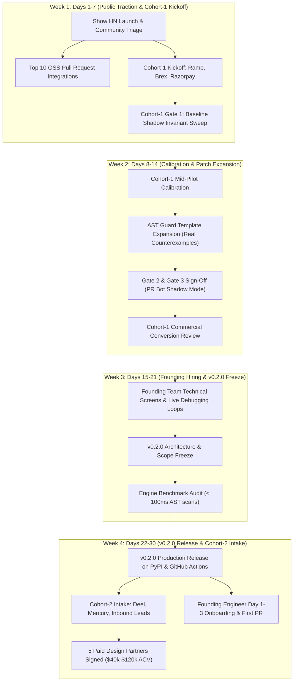

# Ayentra Post-Launch 30-Day Engineering and GTM Execution Roadmap

## 1. Executive Summary and 30-Day North Star

This roadmap defines the four-week operational plan bridging the Ayentra v0.1.0 public launch to the v0.2.0 production release and the conversion of the first five enterprise design partners.

### Core 30-Day Objectives
1. **Commercial Conversion**: Convert Cohort-1 design partners (Ramp, Brex, Razorpay) and onboard Cohort-2 (Deel, Mercury) to secure 5 annual production subscriptions ($40,000 to $120,000 ACV).
2. **Product Evolution (v0.1.0 to v0.2.0)**: Harden AST invariant synthesis, expand concurrency race detection across asynchronous Python runtimes, and reduce average verification latency below 1.5 seconds.
3. **Open Source Adoption**: Complete 10 reference pull request integrations across tier-1 open source repositories to build bottom-up developer credibility.
4. **Founding Team Onboarding**: Screen, hire, and onboard the Founding Verification Engine Engineer and Founding Repair Engineer using the standard calibration and scorecard packets.

### Primary Metrics and Key Results
- **Paid Conversions**: 5 signed enterprise contracts by Day 30.
- **OSS Traction**: 10 merged reference PRs; 500+ GitHub stars; 5,000+ PyPI downloads.
- **Verification Accuracy**: Zero false-positive invariant halts across production shadow runs; 100 percent candidate patch pass rate on 3-gate sandbox checks.
- **Hiring Velocity**: 1 founding engineer hired and shipping production code within 72 hours of start date (Day 30).

---

## 2. Master Milestone Dependency Architecture

The following Mermaid diagram maps the critical path across engineering releases, design partner cohorts, open source integrations, and hiring loops.



---

## 3. Week 1 (Days 1 to 7): Public Reception, OSS Integrations, and Cohort-1 Pilot Kickoff

### Primary Objectives
- Maintain 24/7 technical triage across Hacker News, GitHub discussions, and community issue reports.
- Submit high-signal invariant pull requests to 10 tier-1 open source repositories.
- Complete Day 1 to Day 3 environment onboarding for Cohort-1 design partners (Ramp, Brex, Razorpay).

### Daily Execution Breakdown

#### Days 1-2: Launch Triage and Community Grounding
- Execute launch monitoring per `docs/launch_war_room_runbook.md`.
- Monitor PyPI package downloads and GitHub release asset downloads.
- Triage incoming issues within 15 minutes. All technical replies must include executable reproduction snippets.
- Verify showcase landing page uptime and live interactive studio responsiveness.

#### Days 3-4: Top 10 Open Source Repository PR Campaign
- Select 10 reference Python repositories with complex domain models and concurrency (referencing `docs/oss_maintainer_pr_templates.md` and `docs/oss_trojan_horse_audits.md`):
  1. `pydantic/pydantic-core` (Validation boundaries and boundary numeric constraints).
  2. `encode/databases` (Connection pool concurrency and transaction commit state).
  3. `tiangolo/sqlmodel` (Model field validation and relationship balance conservation).
  4. `marshmallow-code/marshmallow` (Schema deserialization edge cases).
  5. `rq/rq` (Redis queue job retry idempotency and state transitions).
  6. `pallets/werkzeug` (Header parsing and URL boundary sanitization).
  7. `spec-first/connexion` (OpenAPI contract adherence).
  8. `tortoise/tortoise-orm` (Transaction isolation and deadlock recovery).
  9. `agronholm/anyio` (Structured concurrency cancellation scope invariants).
  10. `litestar-org/litestar` (DTO transformation boundary checks).
- Deploy PRs showcasing Ayentra verification receipts (`ayentra-receipt.json`) and minimal counterexamples.

#### Days 5-7: Cohort-1 Design Partner Kickoff
- Engage Ramp, Brex, and Razorpay technical leads via dedicated Slack Connect channels.
- Execute Day 1-2 checklist from `C:\Users\Somay\OpenBot\Shared\ayentra_pilot_conversion_tracker.md`:
  - Run `pip install ayentra` and `ayentra init --ci` in target repositories.
  - Define initial `@invariant` rules on critical ledger and credit models.
  - Run `ayentra check` in shadow mode to capture Gate 1 minimal counterexamples.

### Week 1 Dependencies, Acceptance Criteria, and Risk Triggers
- **Dependencies**: v0.1.0 release artifacts published to PyPI; GitHub Action `ayentra/action@v1` active; showcase site live.
- **Acceptance Criteria**:
  1. Zero unhandled SEV-1 issues during launch window.
  2. 10 OSS pull requests submitted with reproducible invariant receipts.
  3. Gate 1 cleared for at least 2 Cohort-1 accounts (reproducible violation caught in shadow test).
- **Risk Triggers & Action**:
  - *Risk*: Community flags false-positive invariant violation on standard Python dataclasses.
  - *Mitigation*: Engine-Lead deploys patch within 45 minutes; release hotfix `v0.1.1` to PyPI.

---

## 4. Week 2 (Days 8 to 14): Mid-Pilot Calibration, AST Guard Expansion, and Cohort-1 Paid Review

### Primary Objectives
- Conduct mid-pilot technical reviews with Ramp, Brex, and Razorpay engineering leadership.
- Expand AST auto-repair templates in `src/ayentra/repair.py` using production counterexamples gathered from pilot runs.
- Advance Cohort-1 accounts through Gate 2 (sandbox patch verification) and Gate 3 (PR bot shadow deployment).
- Conduct commercial conversion reviews to align on annual contract execution.

### Daily Execution Breakdown

#### Days 8-9: Cohort-1 Mid-Pilot Technical Calibration
- Review real invariant violations detected during Week 1 shadow runs:
  - **Ramp**: Analyze Celery retry state drift in `TransferCanonical`.
  - **Brex**: Review drawdown bound violations during simulated concurrent credit line adjustments.
  - **Razorpay**: Validate nodal escrow conservation across simulated payout retries.
- Verify candidate patches through Ayentra 3-gate sandbox verification protocol.

#### Days 10-11: AST Guard Template Expansion
- Repair-Lead and Engine-Lead inspect real-world counterexamples and expand repair templates:
  - Add nested dictionary boundary guard synthesis (`KeyError` and `TypeError` defenses).
  - Add decimal rounding epsilon guards for multi-currency calculations (`Decimal.quantize` invariant enforcement).
  - Add monotonic counter and state-machine transition guard patterns.
- Run complete regression suite against updated repair templates:
  ```bash
  pytest tests/test_ayentra_engine.py -v
  ```

#### Days 12-14: Gate 3 Deployment and Commercial Sign-Off Preparation
- Deploy Ayentra PR Bot in shadow mode (`continue-on-error: true`) across active staging pull requests in Cohort-1 accounts.
- Monitor 5 consecutive PR runs per account. Verify under 90s runtime and zero developer false alarms.
- Present formal Verification Proof and ROI summary to VP of Engineering and Finance leads.
- Distribute Master Services Agreement (MSA) and Order Form for Gate 4 commercial sign-off ($40k-$120k ACV).

### Week 2 Dependencies, Acceptance Criteria, and Risk Triggers
- **Dependencies**: Cohort-1 Gate 1 counterexamples logged; AST repair engine ready for template addition.
- **Acceptance Criteria**:
  1. 3 new AST guard templates merged into `src/ayentra/repair.py` with 100 percent test coverage.
  2. PR Bot completes 5 consecutive shadow runs in Ramp, Brex, and Razorpay repositories without merge blockage.
  3. Commercial term sheets sent to Cohort-1 accounts.
- **Risk Triggers & Action**:
  - *Risk*: Partner CI runner exceeds 90-second execution time budget.
  - *Mitigation*: Enable caching for AST dependency graphs and set `max-examples = 60` for non-critical paths in `ayentra.toml`.

---

## 5. Week 3 (Days 15 to 21): Founding Team Hiring Loops and v0.2.0 Scope Freeze

### Primary Objectives
- Execute live technical screening and debugging loops for the Founding Verification Engine Engineer and Founding Repair Engineer.
- Grade candidate submissions using the deterministic standards in `docs/candidate_calibration_packet.md`.
- Finalize and freeze feature scope for the upcoming v0.2.0 release.
- Audit verification engine performance against the benchmarks in `docs/benchmarks.md`.

### Daily Execution Breakdown

#### Days 15-17: Technical Screening and Live Debugging Loops
- Administer the standard technical screen: candidate builds `mini_verifier.py` (AST visitor, Hypothesis strategy synthesis, counterexample shrinking).
- Execute the live debugging loop:
  - Candidate inspects a subtle race condition in `concurrency_runner.py` using `sys.settrace`.
  - Grade strictly against Level 2, Level 3, and Level 5 reference samples in `docs/candidate_calibration_packet.md`.
  - Enforce hiring rules: zero gut-feel rejections, deterministic commit evaluation, no corporate jargon.
- Select top candidate and extend formal founding engineer offer.

#### Days 18-19: v0.2.0 Architecture and Scope Freeze
- Convene core engineering leads (CEO, Engine-Lead, Repair-Lead, QA-Gatekeeper).
- Freeze scope for v0.2.0 release:
  1. **Asyncio Concurrency Engine**: Native event loop trace scheduler supporting `asyncio` and `anyio` coroutines alongside threaded execution.
  2. **Multi-File SARIF Aggregation**: Unified code scanning reports across distributed microservice repositories.
  3. **Interactive Studio Enhancements**: Direct terminal patch application (`ayentra apply-patch`) with one-click rollback.
  4. **Performance Engine Optimization**: AST parse caching to ensure sub-100ms analysis on 50,000+ line Python modules.

#### Days 20-21: Benchmark and Regression Audit
- Run exhaustive benchmark suite:
  ```bash
  python -m pytest tests/ -v
  ayentra dogfood --json-out dogfood_v020_receipt.json
  ```
- Verify compliance with performance thresholds:
  - AST scanning latency < 100 milliseconds per module.
  - End-to-end invariant check < 1.5 seconds for standard test suites.
  - Zero regression escapes across all 7 reference dogfooding targets.

### Week 3 Dependencies, Acceptance Criteria, and Risk Triggers
- **Dependencies**: Candidate pipeline sourced by Hiring Partner; candidate calibration packet active; v0.2.0 design proposals reviewed.
- **Acceptance Criteria**:
  1. Founding engineer offer accepted with confirmed start date by Day 25.
  2. v0.2.0 scope frozen with zero unresolved architectural blockers.
  3. Benchmark test confirms sub-100ms AST analysis.
- **Risk Triggers & Action**:
  - *Risk*: Final candidate negotiation stalls over equity or start date.
  - *Mitigation*: CEO steps in for direct founder close; prepare secondary candidate from calibration shortlist.

---

## 6. Week 4 (Days 22 to 30): v0.2.0 Release Gate, Cohort-2 Intake, and Founding Team Onboarding

### Primary Objectives
- Package, verify, and publish Ayentra v0.2.0 to PyPI and GitHub Marketplace.
- Kick off Cohort-2 design partner onboarding with Deel, Mercury, and inbound enterprise leads.
- Onboard new founding engineer using the 72-hour fast-track protocol in `docs/onboarding_30_60_90_scorecard.md`.
- Close and celebrate the first 5 paid design partner contracts.

### Daily Execution Breakdown

#### Days 22-24: v0.2.0 Release Candidate and Validation Gate
- Cut release branch `release/v0.2.0`.
- Execute full cross-platform CI verification (Linux, macOS, Windows across Python 3.10 through 3.13):
  ```bash
  python -m build
  python -m venv test_v020_env
  test_v020_env/bin/pip install dist/ayentra-0.2.0-py3-none-any.whl
  test_v020_env/bin/ayentra check examples/customer_pilot.py --sarif v020_report.sarif
  ```
- Publish v0.2.0 release to PyPI and update GitHub Action pointer `ayentra/action@v1`.
- Update documentation and showcase site to highlight async verification capabilities.

#### Days 25-27: Founding Engineer Day 1-3 Onboarding
- Day 1: Local environment setup in under 45 minutes; complete clean repository build.
- Day 2: Architecture walk-through of `engine.py`, `repair.py`, and `concurrency.py`.
- Day 3: First production PR merged to main (shipping an AST edge-case transformer or benchmark test), fulfilling the Day-3 shipping rule from `docs/onboarding_30_60_90_scorecard.md`.

#### Days 28-30: Cohort-2 Intake and Milestone 5 Commercial Sign-Off
- Initiate Cohort-2 onboarding:
  - **Deel**: Multi-currency treasury and gross-to-net tax ledger invariants.
  - **Mercury**: Integrations batch reconciliation and transaction verification invariants.
- Secure countersigned commercial contracts from Ramp, Brex, and Razorpay (Cohort-1), plus initial term sheets from Cohort-2.
- Reach 5 enterprise design partners committed to annual production subscriptions.
- Conduct 30-day executive retrospective to set Quarter 1 roadmap milestones.

### Week 4 Dependencies, Acceptance Criteria, and Risk Triggers
- **Dependencies**: v0.2.0 code freeze complete; founding engineer on-site; Cohort-1 commercial approvals processed.
- **Acceptance Criteria**:
  1. Ayentra v0.2.0 published cleanly to PyPI and verified in production CI.
  2. Founding engineer merges first production PR within 72 hours of start.
  3. 5 signed enterprise design partner commitments ($40,000 to $120,000 ACV).
- **Risk Triggers & Action**:
  - *Risk*: Enterprise procurement cycles at design partner delay contract signature past Day 30.
  - *Mitigation*: Issue standard 30-day commercial bridge license with committed signature date; CEO coordinates directly with partner VP of Engineering.

---

## 7. Risk, Blocker, and Escalation Matrix (30-Day Trajectory)

| Category | Risk Scenario | Probability | Impact | Mitigation Strategy | Owner |
| :--- | :--- | :--- | :--- | :--- | :--- |
| **Technical** | Asyncio scheduler causes deadlocks in complex customer coroutine trees | Medium | High | Sandbox isolation aborts tests exceeding 5 seconds; fall back to AST static analysis | Engine-Lead |
| **Performance** | Property tests exceed 90-second CI budget on repositories with 1,000+ classes | High | Medium | Implement smart diff targeting to run Ayentra checks only on modified AST call graphs | Engine-Lead |
| **Commercial** | Enterprise legal teams demand custom IP indemnity and security audits | High | High | Deliver completed `docs/enterprise_security_pack.md` and zero-code-egress verification proof | CEO |
| **Hiring** | Candidate fails to ship production PR by Day 3 of onboarding | Low | High | Pair candidate directly with Repair-Lead for 4-hour focused unblocking session | Hiring Partner |
| **Community** | Upstream Hypothesis or Pytest update introduces breaking API change | Low | Medium | Pin exact build dependencies in `pyproject.toml`; run daily canary tests against upstream | QA-Gatekeeper |

---

## 8. Operational Cadence and Governance

To maintain continuous alignment across the 30-day sprint, the team follows this governance schedule:

- **Daily Standup (09:00 UTC, 15 minutes)**:
  - Format: Yesterday completed, today planned, blockers identified.
  - Focus: Pilot account conversion status, critical PR triage, candidate interview pipeline.
- **Mid-Week Engineering Sync (Wednesday, 14:00 UTC, 30 minutes)**:
  - Detailed walk-through of AST repair templates, runtime benchmarks, and scheduler edge cases.
- **Weekly Sprint Review & Executive Retro (Friday, 16:00 UTC, 45 minutes)**:
  - Review milestone completion against roadmap schedule.
  - Update live conversion tracker in `ayentra_pilot_conversion_tracker.md`.
  - Confirm Go/No-Go readiness for next week deliverables.
